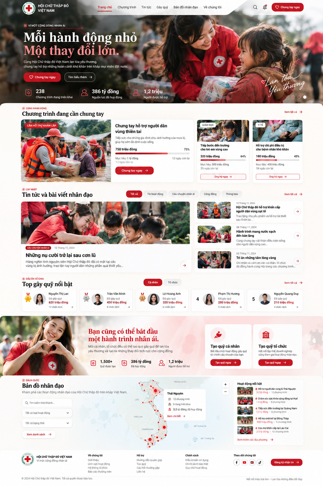

# REDESIGN HOMEPAGE — CỔNG THÔNG TIN HỘI CHỮ THẬP ĐỎ

> **Phiên bản:** 1.0  
> **Ngày:** 08/10/2026  
> **Loại tài liệu:** UI/UX Design Specification — Desktop & Mobile  
> **Concept:** **Human Connection — Kết nối triệu trái tim, lan tỏa những điều tốt đẹp**  
> **Website tham chiếu:** https://ais-pre-5vykn464uomjzyny4n3cah-816986775481.asia-southeast1.run.app/  
> **Website tổ chức:** https://redcross.org.vn/

## 1. Mục tiêu thiết kế

Redesign trang chủ thành **cổng thông tin nhân đạo hiện đại, đáng tin cậy, giàu cảm xúc và dễ sử dụng**, vừa thể hiện tính chính thống của Hội Chữ thập đỏ, vừa khuyến khích cộng đồng đóng góp và tự khởi tạo các hoạt động gây quỹ.

### Mục tiêu chính

1. **Tạo ấn tượng và sự tin tưởng ngay từ hero:** hình ảnh con người thật, lời kêu gọi rõ ràng, không lạm dụng hiệu ứng.
2. **Tăng khả năng tiếp cận chương trình quyên góp:** người dùng nhận biết ngay nhu cầu hỗ trợ, tiến độ, đối tượng hưởng lợi và CTA.
3. **Tổ chức thông tin logic:** phân biệt chương trình, tin tức, người gây quỹ, chức năng tạo quỹ và bản đồ tra cứu.
4. **Tôn vinh đóng góp cộng đồng:** ghi nhận cá nhân và tổ chức gây quỹ bằng giao diện tinh tế.
5. **Tạo trải nghiệm xuyên suốt:** mỗi section có đặc trưng riêng nhưng cùng chung một visual language; responsive, accessible và có thể triển khai GSAP.

### Đối tượng người dùng

- Người muốn tìm chương trình để ủng hộ.
- Người cần cập nhật tin tức, hoạt động nhân đạo.
- Cá nhân/tổ chức muốn tạo quỹ.
- Người cần tra cứu các hoạt động nhân đạo theo tỉnh/thành.

## 2. Hình ảnh minh họa concept

**Lưu ý:** hình trên là **mockup concept**, không phải website hoàn chỉnh. Tên người, số tiền, ngày tháng, số liệu gây quỹ, chương trình và thông tin sự kiện trong ảnh chỉ dùng minh họa bố cục; **không được đưa lên website thực tế nếu chưa xác minh và kết nối nguồn dữ liệu chính thức**. Logo và các yếu tố nhận diện phải được thay bằng bộ nhận diện được đơn vị quản lý phê duyệt.

## 3. Visual direction / Design system

### 3.1. Ngôn ngữ thiết kế

- **Phong cách:** Modern Humanitarian Portal + Editorial Photography.
- **Tinh thần:** nhân ái, tích cực, tin cậy, minh bạch, trang trọng nhưng gần gũi.
- **Visual chủ đạo:** photography chân thực về tình nguyện viên, người dân và hoạt động cứu trợ tại Việt Nam; ưu tiên những khoảnh khắc trao nhận, kết nối, nụ cười và hành động cụ thể.
- **Bố cục:** khoảng trắng rộng; một số block full-width để tạo nhịp thị giác; hạn chế các section đều là lưới card 3 cột.
- **UI:** đơn giản, nhận diện rõ các hành động chính, nhãn trạng thái dễ đọc.
- **Tránh:** gradient đỏ dày đặc, stock photo thiếu tự nhiên, quá nhiều icon/đổ bóng, carousel tự động gây phân tâm, animation phô trương.

### 3.2. Color palette đề xuất

| Token | Màu | Mục đích |
|---|---|---|
| `--color-primary` | `#B91C2B` | Đỏ chủ đạo, CTA, điểm nhấn |
| `--color-primary-soft` | `#D9474D` | Hover, accent có kiểm soát |
| `--color-bg` | `#FFF9F5` | Nền trắng ấm cho các khối kể chuyện |
| `--color-surface` | `#FFFFFF` | Nền card, form, bảng |
| `--color-surface-alt` | `#F2F3F4` | Section tương phản nhẹ |
| `--color-text` | `#24272C` | Nội dung chính |
| `--color-text-muted` | `#687078` | Metadata và nội dung phụ |
| `--color-border` | `#E6E7E8` | Đường phân tách, card border |

> Palette là **đề xuất concept**. Khi triển khai sản phẩm thật, màu đỏ và logo phải tuân thủ hệ thống nhận diện chính thức, bao gồm quy định sử dụng biểu trưng Chữ thập đỏ.

### 3.3. Typography

- **UI & nội dung:** `Be Vietnam Pro` (ưu tiên) hoặc `Inter`, hỗ trợ tiếng Việt đầy đủ.
- **Headline editorial (tùy chọn):** serif tương phản cao ở các headline cảm xúc, nhưng dùng nhất quán và tiết chế; không ảnh hưởng tính chính thống.
- **Heading H1 desktop:** 56–76px; mobile: 36–44px.
- **Heading section desktop:** 36–48px; mobile: 28–34px.
- **Body:** 16–18px; line-height khoảng 1.5–1.65.
- **Metadata:** 12–14px; tương phản đủ đọc.

### 3.4. Grid, spacing và components

- **Container:** `max-width: 1280px`, căn giữa; gutter desktop 40–64px, mobile 16–20px.
- **Spacing:** hệ 8px (`8, 16, 24, 32, 48, 64, 96`).
- **Section padding:** desktop khoảng 88–120px, tablet 64–80px, mobile 48–64px; tùy mật độ nội dung.
- **Card radius:** 12–16px; nút CTA dạng pill hoặc bo góc 10–12px.
- **Shadow:** rất nhẹ hoặc thay bằng stroke 1px.
- **CTA chính:** nền đỏ, chữ trắng; CTA phụ: outline hoặc text-link kèm mũi tên.
- **Badge:** phân biệt rõ nhãn chủ đề, nhãn thời gian và **trạng thái khẩn cấp**; không sử dụng màu đơn lẻ để truyền đạt trạng thái.

---

## 4. Information architecture trang chủ

Giữ nguyên **thứ tự 6 nhóm nội dung chính** người dùng yêu cầu, cùng header và footer:

1. **Hero** — visual lớn, thông điệp, CTA và chỉ số tác động.
2. **Chương trình đang cần chung tay** — campaign nổi bật và các campaign khác.
3. **Tin tức và bài viết nhân đạo** — câu chuyện, tin hoạt động, cập nhật.
4. **Top gây quỹ nổi bật** — hai tab **Cá nhân / Tổ chức**.
5. **Tạo quỹ cá nhân, tổ chức** — hai hành động riêng biệt.
6. **Bản đồ nhân đạo toàn quốc** — map tương tác và tra cứu địa phương.
7. **Footer** — thông tin tổ chức, liên hệ, chính sách, hỗ trợ.

**Mạch trải nghiệm:** Cảm xúc → Hành động ủng hộ → Tìm hiểu → Ghi nhận người đóng góp → Chủ động tạo quỹ → Khám phá phạm vi hoạt động toàn quốc.

## 5. Đặc tả chi tiết từng section

### 5.0. Header / Navigation

**Desktop:** header phủ lên hero hoặc đặt trong dải nền trắng bán trong suốt có độ tương phản đủ tốt.

- Logo và tên tổ chức ở góc trái.
- Menu: `Trang chủ` · `Chương trình` · `Tin tức` · `Gây quỹ` · `Bản đồ nhân đạo` · `Về chúng tôi`.
- Công cụ phụ: tìm kiếm và thông báo/tài khoản **chỉ khi hệ thống thực sự có chức năng**.
- CTA nổi bật bên phải: **Chung tay ngay**.
- Khi cuộn: chuyển thành sticky header gọn; logo không bị co nhỏ đến mức khó nhận diện.

**Mobile:** logo + menu button + một CTA rõ ràng; mở menu dạng panel dễ truy cập bằng bàn phím và screen reader.

### 5.1. Section 01 — HERO: Lan tỏa lòng nhân ái

**Mục tiêu:** gây ấn tượng, tạo tin cậy và hướng người dùng đến quyên góp.

**Bố cục:**

- Hero full-width; desktop có thể chiếm ~85–100vh, không bắt buộc full viewport trên màn hình thấp.
- Ảnh documentary chất lượng cao phủ nền; bố trí nhân vật/hành động ở nửa phải để dành không gian chữ bên trái.
- Gradient tối rất nhẹ ở phía chữ, giúp typography rõ ràng mà vẫn giữ chất ảnh.
- Không để chữ che mặt nhân vật hoặc vật phẩm quan trọng.
- Khu vực nội dung bên trái theo hierarchy:
  1. Eyebrow: `VÌ MỘT CỘNG ĐỒNG NHÂN ÁI`
  2. H1: `Mỗi hành động nhỏ. / Một thay đổi lớn.`
  3. Mô tả 1–2 dòng về kết nối và sẻ chia.
  4. CTA chính: `Chung tay ngay`; CTA phụ: `Tìm hiểu thêm`.
- Dưới hero có **3 chỉ số tác động** (ví dụ loại dữ liệu: chương trình đang triển khai / tổng nguồn lực được huy động / người được hỗ trợ). Chỉ hiển thị **giá trị lấy từ nguồn được xác minh**; nếu chưa có dữ liệu, dùng nội dung thay thế có ý nghĩa hoặc ẩn chỉ số.

**Animation:** background scale nhẹ `1.06 → 1`; H1 text reveal theo dòng; KPI fade-up theo thứ tự; parallax nhẹ khi scroll.

**UX:** CTA hoạt động ngay khi trang hiển thị; không yêu cầu chờ animation intro. Nếu hero có nhiều slide, ưu tiên điều khiển thủ công và không tự động chuyển khi đang đọc.

### 5.2. Section 02 — CHƯƠNG TRÌNH ĐANG CẦN CHUNG TAY

**Mục tiêu:** chuyển đổi thành hành động ủng hộ.

**Bố cục desktop:**

- Header section gồm eyebrow `CÙNG HÀNH ĐỘNG`, H2 và link `Xem tất cả`.
- Lưới bất đối xứng: **01 featured campaign chiếm khoảng 50% chiều rộng + 02 campaign nhỏ** bên phải (hoặc 1 featured ngang lớn kèm 2 card dọc).
- Ảnh người thật, thẻ nền trắng; featured campaign có tỷ trọng thị giác cao hơn.

**Dữ liệu trên card:**

1. Ảnh chiến dịch (đúng thực tế).
2. **Trạng thái** — `Cần hỗ trợ khẩn cấp`, `Đang gây quỹ`, `Đã hoàn thành`… đặt ở vùng đầu nội dung, ngay trước tiêu đề hoặc ở mép ảnh dễ thấy; không trộn với tag phân loại.
3. Tiêu đề rõ, tối đa khoảng 2 dòng.
4. Mô tả ngắn 1–3 dòng.
5. Số tiền đã huy động / mục tiêu / phần trăm tiến độ.
6. Progress bar trực quan, có nhãn chữ và giá trị tương đương cho công nghệ hỗ trợ.
7. Thời gian còn lại **chỉ khi chương trình có hạn kết thúc rõ ràng**.
8. CTA `Ủng hộ ngay` hoặc `Xem chương trình` tùy flow.

**Điểm cần lưu ý:**

- Trạng thái **khẩn cấp** phải phân biệt với **category** (giáo dục, y tế, cứu trợ…).
- Không giả định mọi campaign đều có mục tiêu tiền hoặc ngày kết thúc.
- Nếu đạt mục tiêu, không để progress bar hoặc lời kêu gọi gây hiểu lầm.
- Trên mobile: card featured lên trước, card còn lại xếp dọc hoặc swipe có nút điều hướng.

**Animation:** card reveal khi vào viewport; progress bar animate đến giá trị thực, không tự tăng số tiền giả.

### 5.3. Section 03 — TIN TỨC VÀ BÀI VIẾT NHÂN ĐẠO

**Mục tiêu:** tăng nhận thức, khả năng khám phá nội dung và niềm tin vào tổ chức.

**Bố cục:** *Editorial Magazine*, thay cho 3 card giống hệt nhau.

- Tiêu đề section, link `Xem tất cả`.
- Bộ lọc khi có dữ liệu: `Tất cả` · `Tin hoạt động` · `Câu chuyện nhân ái` · `Cộng đồng` · `Thông báo`.
- Bên trái: **featured story**, ảnh lớn, category, ngày đăng, tiêu đề nổi bật, mô tả.
- Bên phải: 2–3 bài dạng thumbnail nhỏ + title + ngày + mô tả gọn.
- Click toàn bộ vùng card hoặc tiêu đề để đọc bài viết.

**UX:** phân biệt rõ *tin tức chính thức* và *câu chuyện truyền cảm hứng*. Ngày tháng, tiêu đề, ảnh và đường dẫn phải lấy từ CMS. Giữ ảnh consistent ratio, tránh crop làm mất chủ thể.

**Animation:** image reveal qua mask nhẹ, card fade-up; không dùng hiệu ứng chữ nảy gây phân tâm.

### 5.4. Section 04 — TOP GÂY QUỸ NỔI BẬT

**Mục tiêu:** ghi nhận đóng góp và tạo động lực tham gia mà không biến hoạt động nhân đạo thành cuộc đua thiếu phù hợp.

**Bố cục:**

- Eyebrow `DẤU ẤN SẺ CHIA`, H2 `Top gây quỹ nổi bật`.
- Segmented control: **Cá nhân | Tổ chức**.
- Desktop: 3–5 hồ sơ nổi bật theo hàng ngang hoặc 3 thẻ nổi bật + danh sách bổ sung.
- Thông tin mỗi hồ sơ: thứ hạng, avatar/logo, tên, tổng gây quỹ, số chiến dịch (nếu có) và link tới hồ sơ.
- Có thể sử dụng điểm nhấn màu nhẹ cho top 3; không dùng huy chương/cúp quá dày đặc.

**Quy tắc dữ liệu:** ghi rõ **thời kỳ xếp hạng** (tháng/quý/năm/toàn thời gian), cách tính và thời điểm cập nhật. Không hiển thị thông tin cá nhân ngoài phạm vi được cho phép.

**Animation:** chuyển tab tức thời hoặc crossfade ~200ms; không làm lại toàn bộ hiệu ứng mỗi khi tab đổi.

### 5.5. Section 05 — TẠO QUỸ CÁ NHÂN / TỔ CHỨC

**Mục tiêu:** dẫn người dùng từ cảm xúc và tin tưởng sang hành động chủ động.

**Visual:** full-width storytelling banner, ảnh nhóm tình nguyện viên Việt Nam chân thực. Có thể dùng nền trắng ấm pha sắc đỏ rất nhẹ.

**Headline đề xuất:** `Bạn cũng có thể bắt đầu một hành trình nhân ái.`

**Bố cục desktop:**

- Ảnh chân thực bên trái hoặc trải rộng làm nền có kiểm soát.
- Khối nội dung và 2 card CTA rõ ràng bên phải.
- Card 1: **Tạo quỹ cá nhân** — icon người, mô tả ngắn, CTA `Tạo quỹ ngay`.
- Card 2: **Tạo quỹ tổ chức** — icon tòa nhà, mô tả ngắn, CTA `Tạo quỹ ngay`.
- Có thể bổ sung dòng `Tìm hiểu quy trình xác minh` để tăng tin cậy.

**UX:** người dùng hiểu ngay sự khác nhau giữa hai hình thức; CTA điều hướng đến form/flow tương ứng; nêu rõ điều kiện và bước xét duyệt trước khi gửi đăng ký.

**Animation:** ảnh reveal bằng clipping mask, 2 card xuất hiện lần lượt nhẹ nhàng. Hover chỉ nâng card rất nhẹ và đổi màu viền/nút.

### 5.6. Section 06 — BẢN ĐỒ NHÂN ĐẠO TOÀN QUỐC

**Mục tiêu:** thể hiện phạm vi hoạt động và giúp người dùng tra cứu theo địa phương.

**Bố cục desktop:**

- H2 `Bản đồ nhân đạo`, một mô tả ngắn.
- **65%:** bản đồ Việt Nam với điểm dữ liệu hoặc nhóm điểm được tổng hợp theo mức zoom.
- **35%:** panel tìm kiếm, lọc và danh sách hoạt động/địa phương nổi bật.
- Filter: tỉnh/thành, loại hoạt động, trạng thái (chỉ khi backend hỗ trợ).
- Click địa phương → panel chi tiết: tên địa phương, hoạt động hiện có, dữ liệu xác minh và link xem chi tiết.

**Yêu cầu kỹ thuật và UX:**

- Ưu tiên SVG Việt Nam tương tác hoặc giải pháp map có dữ liệu địa lý chính xác; không dựng hình bản đồ bằng ảnh tĩnh khi cần click/filter.
- Hiển thị thông tin quốc gia, ranh giới và tên địa phương dựa trên bộ dữ liệu địa lý chính thức đã được phê duyệt và cập nhật.
- Có trạng thái loading, không có dữ liệu, lỗi tải dữ liệu.
- Trên mobile hoặc với người dùng bàn phím/screen reader, có **danh sách địa phương tương đương** để thao tác không phụ thuộc vào bản đồ.
- Không tạo hiệu ứng WebGL nặng nếu không tạo thêm giá trị tra cứu.

**Animation:** điểm dữ liệu xuất hiện dần khi section vào viewport; thao tác zoom/filter mượt, không làm giảm khả năng đọc số liệu.

### 5.7. Footer

- Logo và tên đơn vị.
- Giới thiệu / lĩnh vực hoạt động.
- Hỗ trợ / hướng dẫn quyên góp / câu hỏi thường gặp.
- Chính sách / điều khoản / bảo mật / liên hệ.
- Kênh mạng xã hội chính thức và đăng ký nhận tin **nếu hệ thống có hỗ trợ**.
- Thông tin bản quyền và pháp lý được xác thực.

Footer nên sáng, gọn, đáng tin cậy; không cần một mảng đỏ lớn nữa sau section bản đồ.

---

## 6. Hành trình người dùng (UX flows)

### 6.1. Quyên góp

`Trang chủ → Chương trình cần chung tay → Trang chi tiết chương trình → Ủng hộ → Thanh toán/Xác nhận → Kết quả & thông tin minh bạch`

- CTA rõ ràng và nhất quán.
- Tại trang chi tiết nên có: mục tiêu, đối tượng hưởng lợi, đơn vị tổ chức, thông tin cập nhật, khoản đã nhận và cách sử dụng đóng góp (trong phạm vi được công khai).
- Không trộn *nút đọc tin* với *nút quyên góp*.

### 6.2. Tạo quỹ

`Trang chủ → Chọn cá nhân/tổ chức → Xem điều kiện → Đăng ký/Đăng nhập (nếu cần) → Điền thông tin → Gửi xác minh → Theo dõi trạng thái`

### 6.3. Tra cứu bản đồ

`Trang chủ → Bản đồ → Tìm kiếm/Lọc tỉnh thành → Chọn địa phương → Xem danh sách hoạt động → Xem chi tiết`

---

## 7. Motion system — GSAP / ScrollTrigger

Định hướng: **animation phục vụ storytelling và thông tin, không gây chậm thao tác**.

| Vị trí | Hiệu ứng | Mức độ |
|---|---|---|
| Hero | Image scale `1.06 → 1`, headline reveal, KPI fade-up | Nhẹ–trung bình |
| Hero → Campaign | Parallax nhẹ + chuyển nền tự nhiên | Nhẹ |
| Campaign | Card stagger, progress bar vào giá trị thật | Nhẹ |
| News | Mask image reveal, text fade-up | Nhẹ |
| Ranking | Tab crossfade 150–250ms, item reveal | Nhẹ |
| Create fund | Photo clip reveal + card stagger | Nhẹ–trung bình |
| Map | Reveal chấm địa phương, smooth filter/zoom | Nhẹ |

**Quy tắc triển khai:**

- UI microinteraction khoảng 150–250ms; reveal section khoảng 500–900ms.
- CTA xuất hiện và click được ngay cả khi animation chưa chạy xong.
- Sử dụng `prefers-reduced-motion` để tắt hoặc giản lược animation.
- Không pin nhiều section liên tục làm scroll khó đoán; không bắt người dùng cuộn qua intro 3D dài.
- Tránh hiệu ứng thay đổi layout liên tục gây CLS.
- Khi dùng GSAP, cleanup animation/ScrollTrigger khi component unmount; hạn chế tạo trigger cho từng item số lượng lớn.

## 8. Responsive behavior

| Viewport | Nguyên tắc |
|---|---|
| ≥1440px | Container 1280px; hero lớn; campaign featured + 2 card; editorial 2 cột; map 65/35 |
| 1024–1439px | Giảm gutter, scale typography; các card không co quá hẹp |
| 768–1023px | Bố cục campaign linh hoạt 2 cột; ranking dạng scroll ngang có điều khiển; map dưới panel nếu cần |
| ≤767px | Hero cao theo nội dung, ảnh focal point rõ; card xếp dọc; news một cột; map + danh sách tra cứu thay thế |

Trên mobile, header, CTA ủng hộ, thông tin tiến độ và các form/filters phải dễ thao tác bằng một tay. Tránh chữ trắng trên vùng ảnh sáng thiếu tương phản.

## 9. Content & data requirements

**Bắt buộc kết nối dữ liệu thực** cho:

- Tên, mô tả, ảnh, trạng thái và thời gian của chương trình.
- Tiến độ huy động, mục tiêu, tình trạng chương trình.
- Tin tức/bài viết, category, ngày đăng.
- Bảng xếp hạng cá nhân và tổ chức, kỳ thống kê và cơ chế tính.
- Chỉ số tác động trên hero.
- Bản đồ, danh sách địa phương và hoạt động.

**Không được:** dùng số liệu, ảnh hoặc tên người trong mockup như thông tin chính thức; đưa dữ liệu gây quỹ cá nhân ra công khai khi không có quyền; tạo thông báo khẩn cấp giả; hiển thị con số đang thay đổi mà không có nguồn xác thực.

## 10. Accessibility, performance & SEO

- Đặt semantic heading đúng thứ bậc `H1 → H2 → H3`.
- Contrast tối thiểu theo WCAG AA, đặc biệt CTA và chữ trên ảnh.
- Nút có tên accessible; filter, tab và map có keyboard interaction/focus state.
- Ảnh có `alt` phù hợp, tránh mô tả rườm rà mang tính cảm tính.
- Progress bar có nhãn, số tiền, mục tiêu và tỷ lệ bằng text; không chỉ dựa vào màu.
- Ưu tiên ảnh WebP/AVIF, `srcset`, lazy-load phần dưới màn hình; hero preloaded có kiểm soát.
- Giữ layout ổn định bằng aspect ratio/size trước khi ảnh và dữ liệu tải.
- Nội dung bài viết/chiến dịch có structured metadata và trang riêng; tiêu đề/link đầy đủ ngữ nghĩa.
- Kiểm thử slow network, thiết bị cấu hình thấp và chế độ reduced motion.

## 11. Tiêu chí nghiệm thu (Acceptance criteria)

- [ ] Trang chủ có đầy đủ 6 nhóm nội dung đúng thứ tự và footer.
- [ ] Hero dùng ảnh nhân đạo chân thực, có thông điệp, CTA rõ ràng và không che khuất chủ thể.
- [ ] Mỗi campaign thể hiện rõ tên, trạng thái, số liệu thực (nếu có) và hành động.
- [ ] Card khẩn cấp khác biệt vừa đủ, không nhầm với category.
- [ ] Tin tức dạng editorial, dễ đọc, tránh card đồng đều quá mức.
- [ ] Ranking có 2 tab cá nhân/tổ chức; kỳ thống kê và số liệu được xác thực.
- [ ] Hai flow tạo quỹ được phân biệt bằng nội dung và CTA.
- [ ] Bản đồ có filter và tương tác; mobile có danh sách thay thế.
- [ ] UI đồng bộ typography, spacing, màu và component.
- [ ] Animation không chặn thao tác; hỗ trợ reduced motion.
- [ ] Giao diện đạt yêu cầu desktop/tablet/mobile và các trạng thái loading/empty/error.
- [ ] Nội dung, logo, nguồn thống kê và thông tin pháp lý đã được chủ website duyệt.

## 12. Thứ tự ưu tiên triển khai

1. **Phase 1 — Visual direction:** chốt header, hero, campaign featured và hệ thống typography/màu.
2. **Phase 2 — Core homepage:** dựng news, ranking và tạo quỹ; kết nối data/CMS.
3. **Phase 3 — Bản đồ:** dữ liệu địa phương, filter, tương tác và phiên bản accessible.
4. **Phase 4 — Motion & polish:** GSAP/ScrollTrigger, responsive polish, accessibility, performance, QA.

## 13. Handoff ngắn cho Designer / Developer

> Thiết kế lại homepage Cổng thông tin Hội Chữ thập đỏ theo concept **Human Connection**, hướng **modern humanitarian portal**. Giữ nguyên cấu trúc: Hero → Chương trình đang cần chung tay → Tin tức và bài viết nhân đạo → Top gây quỹ (Cá nhân/Tổ chức) → Tạo quỹ cá nhân/tổ chức → Bản đồ nhân đạo toàn quốc → Footer. Hero full-width dùng ảnh con người chân thực, có headline lớn và CTA “Chung tay ngay”. Các chiến dịch thiết kế theo layout featured + cards, ưu tiên trạng thái, số liệu tiến độ và CTA. Tin tức trình bày như editorial magazine. Ranking dùng tabs, tạo quỹ dùng 2 lựa chọn CTA. Bản đồ có tra cứu tỉnh/thành, bộ lọc và danh sách thay thế cho mobile. Visual trắng ấm / đỏ thương hiệu / chữ charcoal, typography rõ ràng, spacing thoáng, GSAP chuyển động nhẹ. Dữ liệu mockup chỉ là placeholder; mọi thông tin chính thức phải lấy từ CMS/API đã được xác minh.

---

**Ghi chú:** Tài liệu này là bản đặc tả concept UI/UX dựa trên các section đã thống nhất và ảnh mockup, **chưa phải audit hoàn chỉnh của source code hoặc dữ liệu website hiện hành**. Các thông số layout là giá trị đề xuất để bắt đầu thiết kế và có thể được điều chỉnh khi dựng trên Figma/triển khai frontend.
